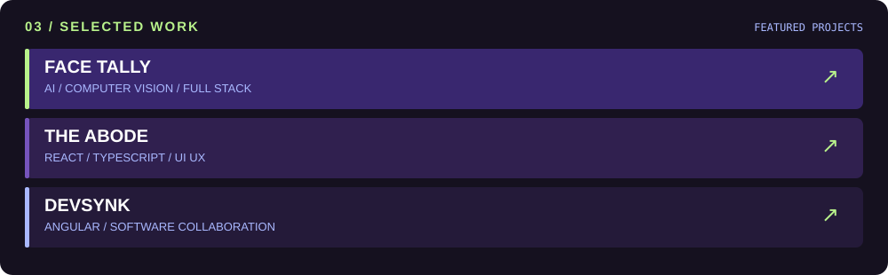

### `01 / about`

Software developer building thoughtful web applications and exploring intelligent systems.

`Currently building: DevSynk` · `AI & Cloud` · `One Dev Hackathon — 2nd Place`

### `02 / toolkit`

**LANGUAGES**

**FRAMEWORKS & DATA**

**AI & TOOLS**

**`code. create. evolve.`**

**`code. create. evolve.`**

